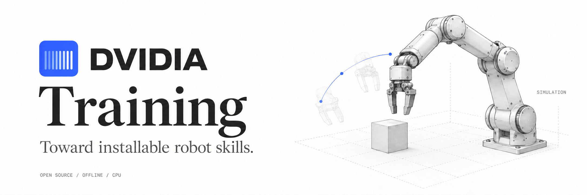

# DVIDIA Training

**[Task environment studio preview: 0.1.3.dev2](https://github.com/Dvidia-Inference/dvidia-training/releases/tag/task-environments-v0.2-preview).**
Edit multi-object scenes locally and run CPU physics through the simple browser studio or `dvidia-environment` Terminal tools.
The pinned PiPER, open bin and original rigid objects retain **6 accepted fixtures, 6 rejected negative fixtures and 4 refused invalid layouts**.
This is passive environment infrastructure: the arm holds home, and no robot skill is learned.
Install the separate preview wheel with its `usd` extra; the default branch's stable package remains 0.1.2.
[Local UI and Terminal guide](https://github.com/Dvidia-Inference/dvidia-training/blob/task-environments-v0.2-preview/docs/task-environments-v02.md) ·
[Environment studio and recorded benchmark](https://dvidia-robot-simulation-lab.static.hf.space/task-environments/v02-reader02/index.html) ·
[Complete evidence](https://huggingface.co/datasets/Dvidia/task-environments-v02) ·
[Research](https://research.dvidia.org/papers/task-environments-v02/).

**[Native PiPER capture preview: 0.1.3.dev1](https://github.com/Dvidia-Inference/dvidia-training/releases/tag/piper-action-capture-v0.1-preview).**
Capture genuine RGB-D, measured joints/fingers and issued/applied motor references locally through `dvidia-piper-capture`.
Two 1,000-interval runs repeat one fixed start exactly; an interrupted prefix remains unknown. **37 focused tests pass** (including the 27 recorder tests), and a fresh installed wheel captures native frames outside the checkout.
Four object-tracker channels remain missing, so training export refuses. No corrective demonstrations, new learner or hardware qualification is provided.
Install the separate preview wheel with its `arm` extra; the default branch's stable package remains 0.1.2.
[Capture guide](https://github.com/Dvidia-Inference/dvidia-training/blob/piper-action-capture-v0.1-preview/docs/piper-action-capture.md) ·
[Recorded viewer](https://dvidia-robot-simulation-lab.static.hf.space/action-capture/v01/index.html) ·
[Complete evidence](https://huggingface.co/datasets/Dvidia/piper-action-capture-v01) ·
[Research](https://research.dvidia.org/papers/native-action-capture-v01/).

**[New: action-demonstration tools in 0.1.2](docs/action-demonstrations.md).**
`dvidia-action-demo` records and validates causal PiPER motor evidence: camera/state
timing, requested and issued actions, and applied native targets. It preserves
interrupted/failing records and refuses missing, stale or incompatible training
inputs. **27 focused tests pass.** The example is synthetic metadata; live capture,
corrective demonstration collection and learned control remain separate work.
[Install the reviewed Terminal tools](https://github.com/Dvidia-Inference/dvidia-training/releases/tag/training-v0.1.2).

**[New: testable simulation scenes and bounded grip waiting](docs/research-20261030.md).**
A local OpenUSD/PiPER bridge passes **45/45 passive physics checks**, with a
recorded 3D viewer, native Terminal tools and an independently verified release kit.
A separate recovered grip-wait study retains **508 scored attempts and four unknowns**:
strict completions are **42/128 bounded, 32/128 learned clock, 44/128 fixed, 41/128 teacher**;
both paired comparisons are inconclusive.
[Open the workstation](https://dvidia-robot-simulation-lab.static.hf.space/usd-workstation/v01/index.html) ·
[Download and run locally](https://github.com/Dvidia-Inference/dvidia-training/releases/tag/usd-workstation-v0.1) ·
[Grip-wait evidence](https://huggingface.co/datasets/Dvidia/piper-grip-wait-recovery-v04).
These are bounded simulation results; universal video-to-robot learning remains open.

**[PiPER learned grip feedback v0.2](https://research.dvidia.org/papers/learned-piper-grip-v02/).**
A local CPU runner and installable model kit, with all failed experiments retained.
The frozen simulation study completed **6/24** with feedback, **8/24** with its
matched blind learner and **24/24** with the authored teacher. No live-feedback
advantage or physical robot transfer is established.
[Download the installation kit](https://github.com/Dvidia-Inference/dvidia-training/releases/tag/piper-feedback-v0.2) · [Model](https://huggingface.co/Dvidia/piper-block-placement-feedback-v02) · [Full evidence](https://huggingface.co/datasets/Dvidia/piper-block-placement-feedback-demonstrations-v02) · [Tagged source and CLI](https://github.com/Dvidia-Inference/dvidia-training/tree/piper-feedback-v0.2).

[Install locally](docs/installation.md) · [Hardware guide](docs/hardware.md) · [Execution map](docs/roadmap.md) · [Official site](https://dvidia.org/) · [Research](https://research.dvidia.org/papers/skillspace-footage-training/) · [Frozen benchmark evidence](benchmarks/sample-count-19047/README.md)

[Recorded demo](https://huggingface.co/spaces/Dvidia/dvidia-training) · [Synthetic datasets](https://huggingface.co/datasets/Dvidia/dvidia-training-examples) · [Pilot models](https://huggingface.co/Dvidia/dvidia-training-pilot)

**Research alpha.** The recorded demo covers the original one-scene simulation pilot; the frozen benchmark is a separate experiment. Training runs locally. No human-video action bridge or hardware skill is established.

Train a small visual model from Skillspace footage on your own computer or server. The pipeline checks actual videos and source groups, fixes training/development/test splits, fits weights on a CPU, and exports a result with held-out measurements and integrity hashes.

The base install needs **Python 3.12+, NumPy and FFmpeg**. It needs no GPU, CUDA, account or API key. Training is offline by default; downloading software or public footage is a separate, explicit step.

**Visual learning is not an acquired robot skill.** Human videos do not directly supply robot joint commands or contact forces. An optional movement branch requires compatible, validated action supervision; installation and closed-loop qualification remain separate gates.

## Install and open the studio

Install Python 3.12+ and FFmpeg, including `ffprobe`, first. On macOS, `brew install python@3.12 ffmpeg`; on Debian/Ubuntu with Python 3.12+ available, install `python3-venv` and `ffmpeg`. See [platform instructions](docs/installation.md) for Windows PowerShell, disconnected servers and Docker.

macOS / Linux:

```sh
git clone https://github.com/Dvidia-Inference/dvidia-training.git
cd dvidia-training
python3.12 -m venv .venv
.venv/bin/python -m pip install .
.venv/bin/dvidia-training-studio --directory runs/studio
```

Open [http://127.0.0.1:8270](http://127.0.0.1:8270). Select a local Skillspace folder or upload a ZIP, check its footage and groups, train, then inspect and download the result. Larger folders can be supplied by local path. The studio binds only to the local machine; use SSH port forwarding when it runs on a remote server.

For Windows, use `.venv\Scripts\python.exe` and `.venv\Scripts\dvidia-training-studio.exe`; [complete PowerShell commands](docs/installation.md#windows-powershell) are provided.

## Plan the next useful recording

Open [the collection planner](http://127.0.0.1:8270/coverage) in the same local studio. Define the skill's goal, operating envelope, selected conditions and simulation benchmark. The planner suggests a capture brief for a gap and tallies declared independent reviewed groups. Its example records are fabricated; it does not inspect footage or establish training readiness. Export the plan to keep it.

[Collection design and proposed incentives](docs/skillspace-coverage.md) explain complete attempts, review and rights declarations, source grouping, failures and recoveries. Every skill starts with a benchmark description; an unsupported task environment keeps qualification blocked. Collection targets and measured competence are separate.

The [episode tape recorder](docs/episode-tape.md) preserves the existing simulated arm's measured state, requested/applied commands, contacts and sensor ages. Recording needs the optional arm extra; validation and inspection need only Python's standard library. These tools are available from the current checkout and do not train a new policy or change the older Hugging Face pilot.

## DVIDIA Observation Lab

The separately tagged [Observation Lab v0.1 release](https://github.com/Dvidia-Inference/dvidia-training/releases/tag/observation-lab-v0.1.0) provides local CPU object/palm detection, a video review timeline, append-only corrections and JSON export. Install that tag using its [setup and input guide](https://github.com/Dvidia-Inference/dvidia-training/blob/observation-lab-v0.1.0/docs/observations.md); the default training checkout above does not include this feature yet.

[Interactive Hugging Face demo](https://huggingface.co/spaces/Dvidia/observation-lab) · [Research paper and pilot evidence](https://research.dvidia.org/papers/dvidia-observation-lab/) · [Detector provenance and licenses](https://github.com/Dvidia-Inference/dvidia-training/blob/observation-lab-v0.1.0/docs/observation-models.md)

The hosted demo uses DVIDIA-authored synthetic fixtures and browser-local review state. Actual detector inference runs in the installed local tool. The six-excerpt pilot demonstrates integration; annotation accuracy, automatic task understanding and robot learning remain unmeasured. This is an observation workflow, with no newly trained DVIDIA detector weights.

## Try the pipeline

Generate an explicitly synthetic example, then train and verify its output:

```sh
.venv/bin/dvidia-train example --clips 10 --output examples/visual-demo
.venv/bin/dvidia-train run examples/visual-demo --output runs/visual-demo
.venv/bin/dvidia-train inspect runs/visual-demo
```

The example consists of moving-disc videos. It checks the software path and does not demonstrate human-video learning or shoe organization. Each run needs a fresh output directory.

For your own footage:

```sh
.venv/bin/dvidia-train prepare /path/to/skillspace --output runs/checked
.venv/bin/dvidia-train run runs/checked/dataset/dataset.json --output runs/trained
```

A folder of videos is accepted, with lineage/completeness warnings. Prefer an explicit [`skillspace.training.json`](docs/skillspace-format.md). A public catalog page containing only a demonstration count cannot supply training footage.

## Hardware

These are **provisional planning targets for the small default visual learner**, not verified minimum specifications or guarantees for arbitrary datasets.

| Resource | Proposed starting point | Recommended |
| --- | --- | --- |
| CPU | 1 modern CPU core | 2–4 cores |
| RAM | 2 GiB | 4–8 GiB |
| GPU / VRAM | None required | None required for this learner |
| Free scratch disk | 1 GiB for a small example, plus original footage and installed tools | At least 2 GiB, scaled to your dataset |

Allow space for roughly two additional source copies when checking and then training, plus intermediates and exports. Intake is bounded to 500 MiB per source and 128 MiB per video. At the intake ceiling, the extra copies alone can approach 1 GiB; the starter scratch allowance does not cover those copies plus all intermediates. The studio ZIP upload limit is 24 MiB. [Hardware details and checks](docs/hardware.md) explain the estimates.

Development was tested on a macOS Apple M5 machine with 24 GiB RAM. That machine is not the minimum. [All eight checks passed on runtime commit `d1f0cbc`](https://github.com/Dvidia-Inference/dvidia-training/actions/runs/37740260434): visual training and studio tests on Linux/macOS/Windows with Python 3.12 and 3.13, the optional Linux arm pilot, and actual Docker training with networking disabled. Hardware requirements for larger video models or shoe motor policies remain unmeasured. Run `dvidia-training-doctor` to check installed dependencies and local capacity without training.

## What the result means

The default learner fits a training-only PCA representation and a ridge next-frame predictor. Development footage selects regularization; test footage is scored afterward against last-frame and training-mean baselines. Pixel/latent prediction error is a visual diagnostic, not task success, calibrated 3D understanding or robot competence.

`training-result.zip` contains weights, model contracts, measurements, a trimmed dataset receipt and an integrity manifest. Original footage stays in the local prepared dataset and is excluded from the download. Hashes check consistency; they do not authenticate capture history or measured truth.

Related recording/session/shoe-pair IDs and identical video hashes stay in the same connected source group. Group declarations cannot detect every near duplicate. Five-second cuts from one recording are not independent examples, and no video count is a proven sufficiency threshold.

## Optional arm simulation

```sh
.venv/bin/python -m pip install ".[arm]"
```

This adds MuJoCo 3.15.0 for the existing bounded simulation placement adapter, native telemetry examples and `dvidia-skill-capsule`. A movement candidate still needs an explicit compatible task contract and independent closed-loop qualification. It is not a physical robot driver or a learned shoe policy. See [the movement data contract](docs/skillspace-format.md#movement-supervision).

To measure a candidate before improving it, use the [sample-count and simulation benchmark](docs/benchmarks.md). It compares nested sets of whole recordings, keeps development/test footage fixed, freezes candidate weights before evaluation, and reports new-layout outcomes alongside matched open-jaw controls. It runs locally on a CPU and retains failures and qualification receipts. Install from the current source checkout to get `dvidia-training-benchmark`; the frozen v0.1.0 release predates this tool.

## Public pilot on Hugging Face

[Recorded demo](https://huggingface.co/spaces/Dvidia/dvidia-training) · [Synthetic datasets](https://huggingface.co/datasets/Dvidia/dvidia-training-examples) · [Pilot models and measurements](https://huggingface.co/Dvidia/dvidia-training-pilot)

The demo presents saved candidate and open-jaw control playback from one exact simulation scene. Training runs locally; the dataset and model cards document reproducible inputs, CPU measurements and the limits of this research alpha. [Maintainer publishing tools](publishing/huggingface/README.md) stage only the already-public synthetic release and use a credential from macOS Keychain without printing or caching it.

DVIDIA original code is [MIT licensed](LICENSE). The separately tagged Observation Lab's adapted detector code and upstream model artifacts retain [Apache 2.0 licenses and attribution](https://github.com/Dvidia-Inference/dvidia-training/blob/observation-lab-v0.1.0/docs/observation-models.md); its package declares `MIT AND Apache-2.0`. The Hugging Face Observation Lab demo's own code and authored fixtures are MIT, with [third-party boundaries documented separately](https://huggingface.co/spaces/Dvidia/observation-lab/blob/main/THIRD_PARTY.md). Source footage permissions remain independent. Research and measured limitations: [research.dvidia.org](https://research.dvidia.org). Contact: [hello@dvidia.org](mailto:hello@dvidia.org).
