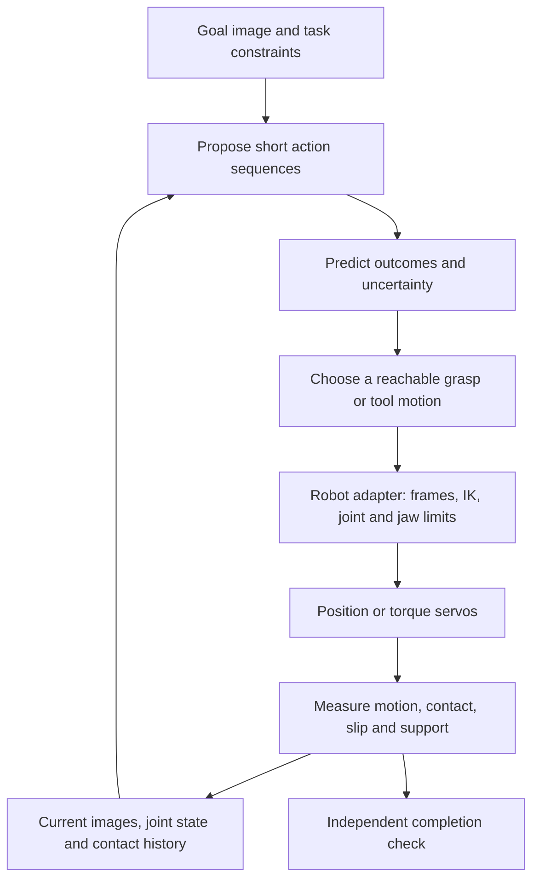

# From a goal image to a physically completed task

DVIDIA research direction · 18 October 2026

A photograph of an organized shoe rack can specify a useful destination. It
does not uniquely specify the motions, forces, intermediate contacts or even
the three-dimensional arrangement needed to reproduce it. Our proposed bridge
is a goal-conditioned planner above a measured, embodiment-specific motor loop.
The visual model proposes progress; independent physical observations establish
whether the robot is holding, moving and releasing the intended object.

## Jev as a candidate decision layer

The referenced model is **Jev by TypeSafe**. Its 14 October release introduces
Jev 1.14, experimental image inputs and a typed bounding-box output. Those
features could help identify the relevant shoe or choose among a small set of
task actions. TypeSafe explicitly describes the new multimodal features as
experimental. [Official release](https://typesafe.ai/blog/jev-1-14).

TypeSafe reports general service response times of 70–500 ms, with its published
evaluations generally made from West Coast laptops calling its nearby service.
This is a vendor claim about those evaluations, not an image-specific robotics
benchmark or evidence of local inference. Typed output prevents a malformed
decision from reaching code; it does not make an incorrect physical judgment
correct. [Launch details and evaluation caveats](https://typesafe.ai/blog/introducing-system-one-models-and-jev).

Our proposed role is a bounded supervisor: identify the target, choose the next
available skill, or request another observation. It would receive current and
goal images plus a concise measured state, and choose from actions the robot
adapter already supports. A bounding box still needs calibrated geometry before
it can become a reachable tool target. Grip checks and stops continue locally
while an optional remote decision is pending. Jev has not been integrated or
benchmarked in our simulator; the local simulation has no dependency on it.

The documented `Box` primitive always returns normalized edges, including when
the requested object is absent. Pair it with a separate presence question and
an evaluated abstention rule. A well-formed box alone cannot authorize a grasp.
Pin `jev-1.14.0` for a comparison instead of a changing alias, and record actual
image-call latency, detection error, false completion and confidence calibration
on our held-out scenes. [Box contract](https://docs.typesafe.ai/primitives/box),
[image inputs](https://docs.typesafe.ai/images),
[model versions](https://docs.typesafe.ai/models).

Its documented offering is a hosted service. We found no released weights for
offline installation, and its current terms restrict distilling the service
into another model. Our local controller would continue to train on our own
licensed robot and simulation records; evaluating Jev is a separate experiment.
[Service terms, sections 1 and 2.3](https://typesafe.ai/legal/mca).

## A related goal-planning precedent

RoboJEPA is separate research, with a paper submitted on 7 October 2026.
It studies action-conditioned latent world models and planning toward
a single goal image, including real-robot tasks. This is directly relevant to
our hypothesis. [Paper](https://arxiv.org/abs/2610.10515),
[official project](https://robojepa.github.io/).

The released planner encodes current observations and the goal, evaluates
candidate action sequences by predicted feature distance, executes an initial
portion and replans. Its documented eager 50M configuration takes about 20 s
per planning iteration at horizon one on an H100; longer horizons cost more.
These are configuration-specific measurements, not universal performance
limits. They do not support a laptop real-time claim. A small predictor alone
also excludes the encoder and the cost of searching many actions.
[Official planning documentation](https://github.com/facebookresearch/robo_jepa/blob/main/docs/planning.md).

The released predictors use the V-JEPA 2.1 ViT-G encoder, separately listed as
two billion parameters. A “22M predictor” therefore does not describe the size
of the complete deployed system.
[Checkpoint requirements](https://github.com/facebookresearch/robo_jepa),
[encoder sizes](https://github.com/facebookresearch/vjepa2#v-jepa-21-pretrained-checkpoints).

The paper describes real-robot translation and gripper planning with fixed
orientation and blocking execution. It explicitly distinguishes this from
real-time operation. This is not evidence of general six-axis dexterous control
or an installed PiPER skill. [Paper, planning and deployment sections](https://arxiv.org/html/2610.10515v1).

The repository declares CC BY-NC-SA 4.0. We have not imported its code or
weights into DVIDIA's MIT tools. Evaluate a specific artifact's terms before
making it a distributed product dependency.
[Repository license](https://github.com/facebookresearch/robo_jepa/blob/main/LICENSE).

## The proposed DVIDIA loop

For a shoe, the goal might mean: the specified shoe is on the assigned shelf,
its toe points in the required direction, it is supported and settled, and the
gripper has released it. A similar-looking image with the shoe still held, the
wrong shoe present or the object hidden behind another object must not pass.
The exact position, angle, force and dwell tolerances belong to a versioned
task benchmark, not an unspecified image-similarity threshold.

The initial goal-conditioned experiment should use a fixed calibrated camera
and a single known object. Cross-camera goals require registration or a
representation that can separate viewpoint from object arrangement. RGB alone
does not reliably identify metric depth, hidden contacts, mass or friction.
Use depth/multiview evidence and calibrated transforms where available, and
keep uncertainty explicit where they are absent.

## How a spatial intention reaches an actuator

1. Estimate the object's pose and candidate grasp relative to the robot base.
   Record camera calibration, object identity and uncertainty. A location in
   image pixels is not a command in metres.
2. Propose a short tool displacement and jaw action. The contract must name
   frame, translation/rotation units, jaw semantics, duration and observation
   timestamp. Different robots do not share joint order or gripper conventions.
3. Convert the tool target to feasible joint targets using the selected robot's
   kinematics, or a separately validated learned action adapter. Check joint
   limits, reachable workspace and collisions supported by that profile.
4. The robot's servo system converts joint error into bounded motor effort.
   Record issued targets and measured response separately. A force limit is
   not a measurement of fingertip normal force.
5. Reobserve and interrupt or replan when the expected motion or grip does not
   occur. Stale visual plans must not suppress local contact or stop responses.

Our existing simplified arm consumes six joint-position targets in radians and
one jaw-gap command in metres, implemented through eight simulated actuators.
Its task controller uses a fixed tool orientation. PiPER is a separate pinned
profile with its own coupling, geometry and controls. Neither current profile
establishes a calibrated physical action adapter. Six arm joints alone do not
mean the present policy learns arbitrary tool orientation.

## Two timescales and learned motor memory

Use a visual planner to choose subgoals; a compatible, appropriately licensed
planner can also generate training examples.
A compact goal-conditioned policy can learn frequent local motions from those
examples and synchronized robot trajectories. Its inputs should include
proprioception and contact history as well as visual features. Measure it on
new layouts before allowing it to replace the planner's decisions.

The fast controller and contact monitor continue between planner updates.
Report capture-to-command latency, observation age, p50/p95/p99/max latency,
missed deadlines, memory and compute separately from model-forward time.
Benchmark on the intended laptop; a GPU predictor throughput figure is not an
end-to-end robot reaction time. Our native simulation cadence is not a measured
camera, sensor or hardware-control rate.

The companion build is a passive native contact audit on the existing
simplified rigid-box profile. It replays frozen commands and compares sampled
physical states to the original episodes. It measures brief contact/force
interruptions that nominally 50 Hz observations can miss. This tests a required feedback
layer, not a visual world model, a PiPER shoe policy or physical hardware.

## What Skillspace needs to retain

Keep synchronized current and goal images, calibrated camera transforms, object
and episode identities, joint/jaw state, issued commands, actuator response,
contact observations, timestamps and the next observations. Preserve the entire
attempt, including unsuccessful grasps, recovery and release. Short video cuts
retain their parent session and physical-instance identity for data splits.

The critical learning record is **observation + action + elapsed time → next
observation and outcome**. Human footage can teach recognition, task structure
and useful priors. Robot interaction records identify the action response for
the named embodiment. Simulation can generate those records cheaply, but its
contacts and actuation still need calibration against physical measurements.

## Smallest falsifiable image-goal experiment

Start with reaching before object pickup. Render a goal view for each declared
reachable tool target in the PiPER workstation, with fixed camera and tool
orientation. Freeze starts, goals, limits and stopping rules before evaluation.
Compare an authored calibrated-state controller, a candidate visual planner,
a hold control and shuffled-goal controls. Report actual tool-position error,
native contacts, command-limit violations and end-to-end compute cost; image
distance is a secondary diagnostic. The state-based controller is privileged,
so it is a reference rather than a fair vision-only baseline.
Reaching success requires a predeclared metric tolerance held for a declared
dwell. Score shuffled-goal controls against the original unshuffled task target,
so they test whether the requested goal actually determines the action.

Advance to pickup and placement only after reaching works. Add independent
retained-lift, release, support and dwell checks, then perturb camera pose,
lighting, occlusion, object placement, force response and sensor delay in
separate reported strata. A policy must improve physical completion without
regressions under the same limits. A prettier predicted scene or a lower
embedding distance is insufficient evidence.

No new world-model weights were trained, downloaded or benchmarked for this
note. This document specifies the next integration experiment; the native
contact audit is a separate implemented measurement tool.
