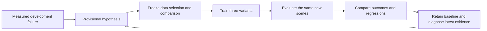

# Skillspace improvement studio

The local pilot implements one complete research cycle:



The current adapter supports native simulated rigid-block placement episodes
with aligned numerical commands. Ordinary phone video can supply observations,
labels and task evidence, but does not provide those commands. No production
account, upload, reward or automatic model promotion is enabled here.

## Open the measured result

After running the [bounded experiment](improvement-experiment.md), supply its
benchmark directory alongside the historical development result:

```sh
PYTHONPATH=src .venv/bin/python -m dvidia_training.improvement_studio \
  benchmarks/sample-count-19047 \
  --evaluation benchmarks/improvement-20261015/benchmark \
  --diagnostic benchmarks/grip-recovery-20261015/phase-one \
  --diagnostic benchmarks/grip-recovery-20261015/phase-two \
  --recovery benchmarks/controlled-recovery-20261015/phase-one \
  --recovery benchmarks/controlled-recovery-20261015/phase-two \
  --retention benchmarks/retention-20261016/phase-one \
  --retention benchmarks/retention-20261016/phase-two \
  --port 8391
```

Open http://127.0.0.1:8391/. A new installation also provides the
`dvidia-improvement-studio` entry point. Omit `--evaluation` to inspect the
original diagnosis before running a comparison. This source checkout includes
the [compact measured receipts](../benchmarks/improvement-20261015/README.md)
needed by the viewer. Raw training data and replay artifacts are not bundled
with the Python package; follow the experiment's source-data setup to rerun it.

The mobile layout leads with the measured result, followed by one next test and
a large brief-download button. The retention view plots measured object-to-hand
drift and distinguishes a sustained lift from completed placement. Recovery
checkpoints use recorded timestamps; missing checks remain unassessed. These
replace the illustrative recovery SVGs. Original benchmark counts, full
instructions, receipts and earlier investigations remain in disclosures. There
is no polling, automatic training or account mutation.

## What changes after an experiment

Before a comparison, the coordinator distinguishes incomplete trials, a failed
negative control, rejected qualification, candidate-only failures, and failures
shared with the authored reference controller. These imply different next steps.
It requests recordings only for a supported candidate-data hypothesis.

After a comparison, the current baseline remains retained. Next investigations
derive from its newly inspected results. Earlier hypotheses become read-only
history. A failed or unsupported hypothesis does not keep generating the same
collection request. Inspecting these cases makes them development evidence;
another improvement claim needs fresh confirmation.

The first [measured result](skillspace-improvement-pilot-20261015.md) kept the
baseline: targeted data tied it, while the chosen general addition regressed.
The remaining failure was shared with the reference controller, so the next
action is a grip/recovery investigation, not a request for more videos.

The [executed diagnostic](grip-recovery-diagnostic-20261015.md) now narrows that
investigation: the controller opens its jaws after detecting relative object
drift, while contacts still exist. More torque or time alone did not repair the
case. A higher simulated jaw capability and longer deadline did. This does not
change the original failed qualification. The subsequent
[controlled-recovery experiment](controlled-recovery-experiment-20261015.md)
tested lowering before release, then holding through measured jaw clearance.
The release handoff improved in sampled evidence; full-task completion stayed
15/16, with no paired completion regressions.

The next [two retention experiments](retention-experiment-20261016.md) tested
increment smoothing and vertical compliance before recovery. The latter achieved
the learned controller's native sustained-lift check and delayed recovery from
13.20 to 14.30 seconds, but placement still failed. Completion remained 15/16,
with zero completion gains or regressions. Neither candidate is promoted. The
current brief investigates contact during loaded transfer, with original force
limits and the 18-second deadline preserved.

Repeat `--diagnostic` in chronological order to include both measured studies.
Omit these arguments to inspect the earlier result alone. The diagnostic panel
shows the latest conditions, total attempts, controls and source hashes;
previous studies remain available in the evidence export. The
[training requirements](video-to-robot-skill-requirements.md) explain the
separate path from video evidence to robot actions and physical validation.

Repeat `--recovery` for its two chronological studies. The latest recovery panel
separates full task completion from clearance before withdrawal. Earlier opening
evidence, repeated study counts and hashes remain in disclosures. These 136
episodes reuse 16 inspected scenes; they are not 136 independent conditions.

Repeat `--retention` in chronological order for both retention studies. Their
136 native episodes include 68 open-jaw controls, all of which failed as required.
The new mechanisms activate only on the known low-force case: the other 15
student scenes reproduce unchanged trajectories. This checks completion
regressions but does not qualify the change across 16 active conditions. The
reader verifies parent lineage, unchanged controls, measured events and native
success checks. Requested motion bounds are distinct from observed servo motion;
the receipt records the small observed descent overshoot.

## Evidence contract

`load_benchmark` checks bounded local receipts, frozen scene hashes, candidate
bindings and complete per-case accounting. Follow-up results must preserve the
source dataset, task, learner recipe, training seed, baseline membership and
held-out source partitions. Named variants are bound to the frozen experiment
plan. Source and inspected development layouts cannot reappear as fresh test
layouts. Nominal and actuator-stress regressions are assessed separately.

These consistency checks do not independently attest real-world capture history
or prove that a generated scene was never seen outside the declared artifacts.
The coordinator uses explicit rules; its diagnoses are provisional hypotheses,
not a model's calibrated causal conclusions.

Diagnostic receipts additionally bind the source benchmark, candidate, runtime,
case and parent study. Every planned condition must account for the student,
teacher and paired open-jaw controls. The original-condition trajectory must
reproduce exactly. Missing attempts, contradictory success metrics and duplicate
studies are rejected; execution errors or successful controls block a positive
interpretation. The viewer never replaces historical benchmark counts with
diagnostic successes.

Read-only routes:

| Route | Purpose |
| --- | --- |
| `/api/improvement` | Current dashboard JSON |
| `/api/improvement/report` | Download the dashboard and receipt references |
| `/api/improvement/brief?id=…` | Download one current investigation |
| `/api/improvement/coverage` | Empty collection plan, only when recordings are supported |

The viewer accepts loopback requests only. Downloads revalidate their source
receipts. An empty collection plan records a request, never invented completed
evidence or a payment entitlement.

## Bridge to the product

The app now has a Task progress entry on Skillspace overviews, separating
demonstrations, demonstration review, simulation and robot validation. Its
counts use existing evidence belonging to the exact Skillspace and task brief;
unknown evidence stays unknown. Human and AI-assisted demonstration assessments
remain separate and do not imply independently verified dense labels. Personal
folders without a canonical task explain that missing definition.

This synthetic placement pilot remains explicitly unlinked to an account
Skillspace. Importing these reports into production requires server-authorized
Skillspace, brief, task and dataset-revision bindings, receipt validation and
separate physical-validation evidence. No caller-supplied title or ID can confer
ownership or mastery. Keep video review, source identities and data rights
connected to each experiment. A background worker should run only
supported, budgeted adapters and preserve all attempts. The account UI should
show one next action and the measured outcome, with detailed receipts available
on demand. Production queueing, entitlements, authentication and a validated
human-video-to-action bridge remain separate work.

For new tasks, first define and validate an observable outcome and a working
controller/environment adapter. A larger upload count does not substitute for
that task contract.

## Verification

```sh
PYTHONPATH=src .venv/bin/python -m unittest discover -s tests -p 'test_improvement*.py'
PYTHONPATH=src .venv/bin/python -m unittest discover -s tests -p 'test_footage_benchmark.py'
PYTHONPATH=src .venv/bin/python -m unittest discover -s tests -p 'test_grip*.py'
PYTHONPATH=src .venv/bin/python -m unittest discover -s tests -p 'test_controlled_recovery*.py'
PYTHONPATH=src .venv/bin/python -m unittest discover -s tests -p 'test_recovery_view.py'
PYTHONPATH=src .venv/bin/python -m unittest discover -s tests -p 'test_retention*.py'
```

The browser suite `tests/browser/improvement_studio.cjs` checks narrow layouts,
touch controls, diagnostic vs collection actions, empty/error states, literal
untrusted text, exported links and completed-result history. Fixture checks do
not count as measured simulation outcomes.
