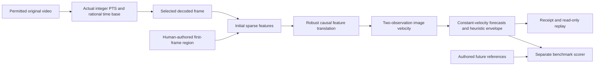

# DVIDIA image-motion alpha

Available in the [candidate source checkout](https://github.com/Dvidia-Inference/dvidia-training/tree/feat/motion-observation-v0.2),
10 October 2026. This is the first
motion component toward [Observation Lab v0.2](observation-v0.2-plan.md); the
full v0.2 remains planned. The published `observation-lab-v0.1.0` tag and
Hugging Face review demo do not include this component.

The tool follows **one human-seeded image region** in permitted local footage,
estimates image velocity and forecasts an image anchor at 100, 250 and 500 ms.
It runs on a CPU and downloads no detector models or weights. It does not train
a model, infer semantic actions or drive a robot.

## Install from source

Install Python 3.12+ and FFmpeg, including `ffprobe`, first. The candidate branch
contains the alpha; cloning the older release tag will not install `dvidia-motion`.
Record the exact checked-out commit when reproducing a result.

```sh
git clone --branch feat/motion-observation-v0.2 https://github.com/Dvidia-Inference/dvidia-training.git
cd dvidia-training
python3.12 -m venv .venv
.venv/bin/python -m pip install '.[observations]'
.venv/bin/dvidia-motion --help
```

The observations extra supplies OpenCV; no detector provisioning command is
needed for this motion baseline. Software installation is separate from local
analysis. Once installed, the analysis, benchmark and replay require no network,
account, API key, CUDA or GPU. On Windows, replace `.venv/bin/` with
`.venv\Scripts\`; see [installation instructions](installation.md).

## First run: authored fixtures

Each output directory must be new; existing evidence is never overwritten.

```sh
.venv/bin/dvidia-motion benchmark --output runs/image-motion-001
.venv/bin/dvidia-motion inspect runs/image-motion-001
.venv/bin/dvidia-motion studio runs/image-motion-001 --port 8286
```

Open [http://127.0.0.1:8286](http://127.0.0.1:8286) to play or scrub the original
generated clips and inspect observations, speed and forecast paths. This is a
read-only local replay. The forecast uses evidence up to the displayed source
time, not frames after it. A source recording clock is not a live wall clock.

The benchmark generates six neutral, authored cases: stationary, constant
velocity, stop/start, direction change, brief occlusion and low texture. The
manual seed is frozen before analysis. Future reference trajectories are passed
only to the scorer, never to the tracker or motion estimator. These fixtures
test tracking and prediction behavior; they cannot establish object detector
accuracy, real-scene generalization or physical robot competence.

The [first measured batch](../benchmarks/motion-alpha-20261010/README.md) retains
coverage, paired baseline errors, failure tails and hardware scope. All six
authored cases completed; occlusion and low texture still lost their tracks.
At 500 ms, the direction-change case reached approximately 90 pixels worst
forecast error. This is a limitation to improve, not a qualified robot forecast.

H.264 benchmark clips need a browser that supports that codec. The replay
reports an unsupported video format instead of substituting a different source.

## Analyze your permitted footage

Use a stationary camera and a textured, clearly visible target for the first
trial. Keep original frame times and the complete motion/outcome. The input
uses the existing strict [`dvidia.observation-source.v1` manifest](observations.md#supply-permitted-videos),
including original SHA-256, session/recording groups, credit, license and an
explicit `local_analysis` permission declaration. The declaration records the
permission you obtained; it does not acquire consent or grant publication rights.

Choose one listed episode and manually specify its first-frame region:

```sh
.venv/bin/dvidia-motion analyze /path/to/source.json \
  --episode attempt-001 --box 0.2,0.2,0.5,0.5 --label 'Cup image anchor' \
  --sample-hz 30 --output runs/cup-motion-001
.venv/bin/dvidia-motion inspect runs/cup-motion-001
.venv/bin/dvidia-motion studio runs/cup-motion-001 --port 8286
```

`--box` is normalized `x1,y1,x2,y2`, from 0 to 1, in the decoded source raster.
It is a human-authored region, not a model detection or proof of physical object
identity. Automatic rotation is disabled; a phone recording's rotation metadata
is not applied to this coordinate system. The first decoded image is retained
as `seed.png` for inspection. Box drawing/correction and automatic semantic
object selection remain subsequent interface work.

## What the baseline computes



The tracker initializes sparse corner features only inside the manual region.
Forward/backward optical-flow checks, minimum support and a robust displacement
consensus reject some ambiguous evidence. The initial region center is translated
by the feature displacement. This **image anchor is not an estimated physical
centroid**. Initial/background feature selection, deformation, rotation and
occlusion can produce drift or loss.

Velocity is the finite difference between two actual, contiguous image anchors.
It is expressed in **analysis-image pixels/second**. Images retain their aspect
ratio and are scaled only when needed to fit a maximum side of 640 pixels; both
original and analysis dimensions and their scale are recorded. Pixel speed
depends on camera geometry and image scaling. It cannot be read as metres/second.

Forecasts extrapolate the current velocity; they do not know that a robot will
push, grasp or release an object. A stop or turn can invalidate the hypothesis.
Coordinates remain unclipped, with out-of-frame forecasts explicitly marked.
The supplied anchor-error radius and its forecast propagation are uncalibrated
heuristics. They are not calibrated confidence regions or safety margins.

Missing evidence is not zero motion. Insufficient or ambiguous support, an anchor
leaving the frame or a tracking gap greater than 250 ms makes the track terminally
lost. No features are replenished and no new object is attached to the old track.
There is no interpolation or forecast through the loss. The velocity estimator
requires observations no more than 150 ms apart; low source or sampling cadence
can therefore prevent all forecasts even when the region is still visible.
Default sampling is 30 Hz; useful cadence is determined by actual source times.

## Timestamps and preserved evidence

FFmpeg streams bounded raw frames. For each selected input frame, the decoder's
integer presentation timestamp is multiplied by its declared rational time base.
The formatted `pts_time` string, nominal frame rate and OpenCV frame-position
values are not substituted for that clock. Selected timestamps begin at zero
and strictly increase. Nonzero container/video starts fail instead of silently
shifting annotations relative to the original media.

Each analysis directory contains:

| File | Evidence |
| --- | --- |
| `original.<extension>` | Byte-preserved copy of the selected video |
| `seed.png` | First decoded analysis image |
| `protocol.json` | Seed/source hashes, recipe, implementation hashes, geometry, clock, software and hardware declarations |
| `rows.json` | Strict causal observation, velocity and forecast rows |
| `frames.json` | Parallel frame index, integer PTS, rational time base and tracking-support metadata |
| `run.json` | Source/protocol/media/row hashes, all errors, coverage and timing |

Once intake begins, a processing failure retains a failed attempt receipt and
any partial rows. Invalid arguments/manifests are rejected before output creation.
`inspect` checks recorded hashes, media bytes and causal row consistency. These
checks establish internal consistency, not authenticated capture history or
independent prediction accuracy. Use trusted local bundles.

## Evaluation and resource scope

The scorer compares constant-velocity predictions with hold-last-position on the
same eligible anchors. It reports current image-anchor and velocity errors,
endpoint error by horizon, denominators, tracking and answer coverage, abstentions,
missing future references and empirical envelope coverage/size. Cases near
velocity discontinuities and occlusions remain explicit. A good conditional
error on a few surviving tracks is not good coverage.

The new command checks one selected source per invocation. The source manifest
may list up to 50 local clips, bounded to 128 MiB each and 512 MiB total. Selected
videos must be at most 60 seconds and 4096 pixels per source side. Analysis is
limited to 1800 frames, a 640-pixel side and requested sampling between 1 and
30 Hz. A lower frame cap can leave later motion unobserved; the receipt records
the cap and final observed source time.

The decoder has bounded timestamp/diagnostic queues and a 120-second watchdog.
A 150-second processing budget is checked between processed frames; native
tracking calls are not preempted. FFmpeg/OpenCV thread settings are requests;
the receipt records OpenCV's reported setting. Per-analysis memory and actual
thread concurrency are unmeasured; the authored benchmark separately records
the process-lifetime resident high-water mark, including fixture generation.
Universal minimum hardware is unmeasured. Allow disk for the source
copy, seed image, receipts and installed software.

Recorded decode/tracking wall times and source-duration ratios describe an
offline batch on the named machine. They do not establish camera-to-command
latency, deadline compliance or live 30 Hz sensing. A fast average replay can
still miss a control deadline.

## Next evidence gates

1. Freeze a development recipe and evaluate independent, permitted real clips
   with separately reviewed anchor references, including blur, stop/turn,
   occlusion, deformation, camera motion and failures.
2. Add measured, bounded streaming replay, then an observation-only live camera
   adapter with capture/delivery/update clocks, dropped frames and stale behavior.
3. Validate geometry/depth before reporting physical speed. Moving cameras need
   independently evaluated camera-motion compensation.
4. Synchronize robot commands, joint/gripper state and available contact sensors
   before action-conditioned interaction prediction or a robot consumer.

The wider roadmap still includes independent annotation scoring, box/event
correction, reviewed dataset exports and skill-specific simulation benchmarks.
Those capabilities are not completed by this image-motion alpha. See the
[motion/interaction plan](motion-prediction-plan.md) and [execution map](roadmap.md).

## Licensing

Original DVIDIA motion, fixture, scoring and replay code is covered by the
repository's [MIT license](../LICENSE). The existing observation detector
adaptations/model notices retain their separate Apache 2.0 terms in
[`third_party/observation-models`](../third_party/observation-models). No model
weights are bundled with this motion component. A source video's own license
and contributor permissions remain independent of the code license.
