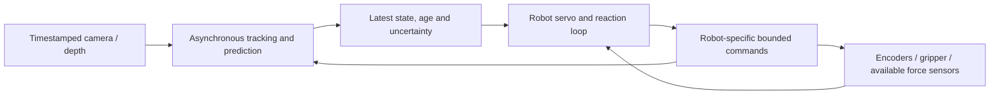

# Motion-aware observation and robot interaction

Proposed 10 October 2026 as an extension of the
[Observation Lab v0.2 plan](observation-v0.2-plan.md). The first
[image-motion alpha](motion-observations.md) is now available in the candidate
source checkout. The full v0.2, calibrated motion and live interaction remain
planned; none are features of the published v0.1 Space.

## Objective and current foundation

Estimate what an object is doing now, predict its short-horizon motion, and
eventually predict its response to a robot action. Update the estimate as new
evidence arrives. Keep observation, estimation, prediction and command separate.

The published observation lab samples two frames/second and associates same-class
boxes by image overlap. The new, separate motion alpha uses a manually seeded
first-frame region and causal sparse feature translation at actual selected
source timestamps. It supplies image-anchor velocity and constant-velocity
forecasts, authored reference scoring and local replay. It has no trained motion
model, calibrated physical speed, automatic semantic object selection or live
camera adapter. The existing reaction monitor consumes metric positions, velocities
and sensor age, currently from synthetic sensed state. Motor memory predicts
one-axis actuator response from delayed observations and acknowledged commands.
Those experiments provide reusable contracts; they do not establish visual
prediction or whole-arm hardware control.

## Incremental deliverables

| Stage | Build | Output and limitation | Gate |
| --- | --- | --- | --- |
| A, first alpha available; v0.2 extension planned | Actual-PTS manual-region feature tracking, two-observation finite-difference velocity and constant-velocity forecasts implemented; detector refresh, forward filter and real-scene evaluation remain planned | Image anchor, direction, analysis-image pixel/s and future path; no metric speed claim | Authored fixture scorer compares hold-last-position; independently reviewed real motion/occlusion clips still required |
| B, calibrated extension | Validated table-plane mapping, then calibrated stereo/RGB-D and camera-to-robot transforms | Planar m/s only for tracked points known to lie on the calibrated plane; full 3D position/velocity requires sufficient calibrated evidence | Compare against independent metric references; reject unsupported geometry and account for camera movement |
| C, interaction evidence | Synchronize video, encoders, gripper aperture, command acknowledgements and available contact/force/tactile signals | Evidence for free motion, approach, attachment, sliding, release or slip; conflicting/missing evidence remains unknown | Clock, freshness, sensor availability and interaction-state accuracy checks |
| D, learned interaction prediction | A compact dynamics model conditioned on state/history and declared robot action | Competing object trajectories and outcomes, with measured uncertainty, at a declared horizon | Improve on simple action-conditioned dynamics in unseen objects/loads/contact cases |
| E, live use | Bounded live adapter and asynchronous state feed; begin in shadow mode with no robot command authority | Fresh state estimates and causal predictions delivered to a robot-specific consumer | End-to-end deadlines, fault behavior and matched closed-loop comparisons; physical qualification remains separate |

For v0.2, ship A alongside independent reference scoring and review improvements.
Add wall-clock-paced replay to test streaming behavior. The first live camera
adapter should run in shadow mode. Recorded replay is not proof of live sensing;
shadow predictions are not proof of successful robot control. Stages B–D are
separate extensions and should not delay a measured image-motion release.

## What movement and speed mean

Use actual acquisition/presentation times, not assumed frame spacing. Track
object-supported features where possible; changing detector rectangles can move
their centers without the object moving. Retain track quality, identity changes,
visibility and uncertainty. Use a causal filter: future frames and backward
smoothing cannot enter a prediction made earlier.

A normal RGB stream first supports image velocity in pixel/s. Camera motion
also produces image motion. Fixed-camera trials simplify the first experiment;
moving/wrist-camera trials need independently evaluated motion compensation.
Depth/calibration supplies the scale and coordinate transforms needed for m/s.
A plane mapping is invalid for a lifted cup or arbitrary 3D motion; do not apply
it to a box centroid and call that calibrated world speed.

Store position, velocity and prediction units explicitly. Angular velocity and
acceleration require additional evidence and validation; box aspect-ratio
changes alone are not reliable rigid-object rotation. Numerical differentiation
can amplify measurement noise. Missing depth or ambiguous identity must not
become a zero speed or fabricated coordinate.

## Predict interaction, including the robot's action

Passive extrapolation asks where the object will go if its current motion
continues. Interaction prediction asks what happens under an action, such as a
gripper approach, push, lift or release. The latter needs robot action/state
history and an interaction model. Requested movement and measured movement
remain distinct; include acknowledged command application where available.

Use simple hypotheses first: stationary/free-moving object, object following a
held tool transform, sliding and uncertain attachment. A visual overlap is not
confirmation of contact or a successful grasp. Force/tactile and relative-motion
evidence can help distinguish regimes, but each sensor's accuracy and freshness
must be evaluated. Friction, mass, compliance and occlusion can make several
futures plausible. Increase uncertainty or abstain when evidence cannot select
a regime; do not silently keep a free-motion extrapolation across contact.

Train a later dynamics model from aligned interaction evidence. Simulation can
provide labels and scoring truth, but deployed inputs must use the declared
sensor observations. Privileged simulator object/contact state must not masquerade
as camera output. Use renderer/sensor adapters for visual-to-control experiments.

## Real-time architecture

The observation worker and robot servo/reaction loop run asynchronously. A slow
detector or language model must not block actuator feedback. Prefer a bounded
latest-frame queue; record skipped frames and use the real time gaps. Keep
monotonic delivery/decision times and an explicit mapping to acquisition clocks,
including offset/drift uncertainty. Never refresh a reading's acquisition time
merely because a consumer reads it again.

Predict to an explicit target time, including expected command-application delay
where the robot adapter can measure it. Freshness, uncertainty and stopping/load
behavior belong to the robot/task envelope. On stale or missing inputs, invoke
the declared robot-specific bounded response rather than advancing with a stale
target. A hold does not automatically recover a slipping load or justify resuming.

An initial development target is a 30 Hz image-state stream on one named CPU
machine, using lower-rate detector refreshes where helpful. It is unmeasured,
not a deadline guarantee or a universal requirement. Choose the final camera
and robot cadence from measured task speeds, precision, delay and stopping
behavior. The robot's servo cadence follows its supported control interface.
At 0.5 m/s, 100 ms of unaccounted delay corresponds to 5 cm of travel; throughput
alone is not the relevant control result.

## Experiments and measurements

Start with stationary-camera cup/table motion, stop/start, changes in direction,
occlusion, lift/release and entry into the scene. Add controlled interaction
examples when suitable robot evidence exists. Include no-motion negatives,
camera motion, blur, variable timestamps, dropped frames and calibration drift.
Keep complete attempts and linked recording/object/session groups together.

Freeze a candidate and protocol before opening fresh confirmation data. At each
prediction time, permit only evidence delivered by that time. Score predictions
against future references without feeding those references into the estimator.
Declared future commands may condition a forecast, but future measurements or
unknown future command acknowledgements may not.

| Measurement | Required evidence |
| --- | --- |
| Current motion | Image position/velocity error separately from calibrated metric position/velocity error; identity switches, track coverage and reacquisition |
| Prediction | Endpoint and average displacement error at proposed 100, 250 and 500 ms horizons; sample counts and error by motion/contact/occlusion condition |
| Uncertainty | Empirical interval/region coverage, region size and abstention; an uncertainty estimate is not calibrated until evaluated |
| Latency | Capture, delivery, inference, state update, decision, request and acknowledged application times; p50/p95/worst, sensor age, jitter and deadline misses |
| Stream health | Queue depth, dropped/late frames, blackout/stale duration, CPU/memory and every failed attempt |
| Control benefit | Current-state-only versus predictive consumer under matched conditions: task success, clearance, overshoot, actual braking path/time, contact and load retention |

Measure long-running stream behavior as well as short clips. Warm offline
processing-time/source-duration ratios remain useful batch metrics; they do not
establish live latency or worst-case execution time. Prediction errors under
contact need their own slices rather than being diluted by easy stationary data.
Physically measured stopping and contact behavior are separate from simulated
scores. Start control integration with the existing bounded fixture, then one
declared robot/gripper configuration; whole-arm geometry requires its own checks.

## Interface and release claims

Show observed boxes, estimated current state and predicted future path with
different visual treatments. Display horizon, acquisition age, units, track
visibility and uncertainty. If calibration is absent, show "metric speed
unavailable". Simulated/synthetic demonstrations remain visibly labeled and
cannot be used as real detector or hardware accuracy evidence.

A motion-aware software alpha can ship once schemas, causal replay, baselines,
review and scoring work. Live-performance claims wait for named-machine stream
measurements. Robot-control claims wait for the compatible consumer and separate
closed-loop results. Keep the public v0.1 tag and its evidence unchanged.

## Primary references

- [OpenCV optical flow](https://docs.opencv.org/4.13.0/d4/dee/tutorial_optical_flow.html)
  describes image motion and sparse tracking, including apparent camera motion.
  It is a candidate baseline, not proof of our achievable throughput.
- [RealSense metric measurement example](https://github.com/realsenseai/librealsense/blob/master/examples/measure/readme.md)
  explains depth/intrinsic-based conversion from pixels to 3D points. Our
  calibration and metric error still require independent validation.
- [MoveIt Servo](https://moveit.picknik.ai/main/doc/examples/realtime_servo/realtime_servo_tutorial.html)
  documents servo interfaces, encoder feedback and control-loop jitter concerns.
  We have not implemented or qualified a MoveIt/hardware adapter in this lab.
