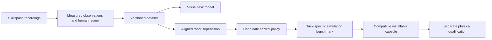

# DVIDIA Observation Lab v0.2 plan

Proposed 10 October 2026. This is an implementation and evaluation plan, not a
release announcement or measured result. It concerns our Observation Lab;
the motor-memory framework has its own v0.2 and a separate scope.

## Product objective

Turn permitted Skillspace footage into portable, reviewed evidence and causal
motion estimates that we can measure and use in learning experiments. The next
release includes image direction/speed and short-horizon forecasts alongside
annotation quality, uncertainty, correction effort and CPU cost. Calibrated
metric motion, action-conditioned interaction prediction and live robot
consumers follow explicit gates in the [motion prediction plan](motion-prediction-plan.md).

The longer product path remains:

Visual descriptions and robot commands have different contracts. A corrected
object box or a description of moving a cup does not supply joint targets,
gripper force, calibrated depth or a deployable movement policy.

## Baseline and gaps

The public baseline is `observation-lab-v0.1.0`, source commit `3cc4a3b`.
Local commit `9fdf2ad` adds grouped review and autosave. Keep both identifiable
when comparing interface behavior. Existing immutable inputs, timestamped
evidence, revisions, conflict handling and local export are the foundation.

Current detection samples two frames/second at a maximum image side of 640.
Same-class box overlap associates detections; palm/object overlap is a 2D
proximity proposal. Six excerpts established integration, with accuracy,
correction effort and peak resources unmeasured. Current reviews edit labels
and intervals, but cannot correct object boxes. The visual trainer does not
consume observation labels, and its movement lane does not consume episode tapes.

## Implementation order

Each row is a separately reviewable change. Evaluation infrastructure can ship
before footage arrives; annotation quality claims require independent evidence.

| Order | Deliverable | Acceptance evidence | Owner role |
| --- | --- | --- | --- |
| 1 | Reference format, annotation guide and scorer | Synthetic exact-match, miss, duplicate, timing and unknown fixtures; unsupported references fail explicitly; missing references return not assessed | Evaluation |
| 2 | Box and task-event correction | Draw/resize/add boxes at real timestamps; split/merge events; keyboard decisions; raw evidence remains immutable; revisions survive reload and conflicts | Product + data |
| 3 | Budgeted batch jobs | Preflight, progress, cancellation, restart and per-clip failure receipts; worker timeout and measured memory/thread use | Runtime |
| 4 | Small independent cohort and review study | Frozen grouped development/confirmation partitions; blinded references; manual versus assisted comparison | Data + evaluation |
| 5 | Temporal proposal experiments | Matched baseline, denser sampling and association ablations; optional captions evaluated separately; complete quality/cost receipts | Learning |
| 6 | Reviewed dataset export and coverage connection | Round-trip validation, stable groups, intended-use permissions and accepted label lineage; unsupported training consumers are explicit | Data + training |
| 7, parallel to 3–5 | Motion estimates and causal image forecasts | Hold-last-position versus constant-velocity baseline; image velocity/prediction error, timestamp/identity checks and occlusion coverage | Perception + evaluation |
| 8 | Streaming replay and shadow live adapter | Bounded newest-frame processing, measured sensor age/latency/jitter, missed deadlines and explicit stale behavior; no robot authority in shadow mode | Runtime + robotics |

The first implementation should be the reference schema/scorer, followed by box
correction. A stronger model cannot be selected credibly before these exist.

## First evidence cohort

Use one bounded task: move a cup onto a clearly marked surface. The cohort is
planned, not collected. Begin with 30–50 complete attempts across several
contributors, sessions, physical cup instances and camera arrangements. Include
successful placement, wrong target, incomplete attempt, occlusion, drops and
recovery. Add short no-cup/no-palm negatives. Record the initial state, complete
attempt and visible outcome; retain longer originals when a 5–6 second excerpt
omits relevant context.

Keep linked originals, sessions, contributor groups, physical instances and
derivatives together. Build split groups from their connected relationships,
including exact duplicates and reviewed near-duplicate candidates. Freeze the
split before fitting recipes. Reserve unseen physical instances and at least
one camera arrangement for confirmation where feasible. If the actual data
cannot support those partitions, report that limitation rather than inventing
independent groups.

Two annotators label confirmation recordings independently, blinded to model
proposals, then adjudicate disagreements. Define visible box extent, occlusion,
identity continuity, event vocabulary, boundary uncertainty and observable
outcome before annotation. References are a separate evidence layer, not ordinary
proposal approvals. Ambiguous or off-camera outcomes remain unknown.

Use this cohort to diagnose the process. Its size is a workload estimate, not
proof that training or rare-error reliability has enough data. Once confirmation
results are inspected, those groups become regression evidence; later
qualification requires fresh confirmation groups.

Shoe pairing/alignment can be the next independent task. Shoe tying requires
deformable simulation work and a different evidence contract. Neither inherits
cup-placement results.

## Measurements and initial targets

The following targets are proposed and unmeasured. Freeze definitions and
thresholds before the confirmation run. Publish denominators, source-group
counts, uncertainty intervals, failures and per-condition results alongside
aggregate values. Small samples may leave a conclusion inconclusive.

| Area | Measurement | Initial development target |
| --- | --- | --- |
| Detection | Same-class one-to-one matches at IoU >= 0.50; precision/recall/F1, separate cup/palm and occluded/small/negative slices | Visible cup precision >= 0.90 and recall >= 0.85; palm results reported separately |
| Tracking | Identity switches, fragmentation and visible-time coverage, separating detection and association failures | Improve on frozen overlap baseline without manufacturing continuity through gaps |
| Observable events | One-to-one same-vocabulary interval matches at temporal IoU >= 0.50; missed/extra events; signed boundary errors | Matched boundary median absolute error <= 0.5 s and p95 <= 1.0 s; report misses alongside errors |
| Outcomes | Confusion matrix with unknown; answer coverage, selective accuracy and false completion | No stronger completion claim until failures and uncertainty are adequately represented |
| Review | Active correction time, elapsed time, additions/rejections and final agreement with independent references | Median active review time >= 25% below manual; final quality within 3 percentage points of manual, subject to uncertainty |
| CPU processing | Cold start and warm job stages; p50/p95 wall-time/source-duration ratio, CPU time, child-process peak RAM, scratch storage and all failed jobs | On the declared CPU reference machine: warm job ratio p50 <= 1 and p95 <= 2, peak process-tree RAM <= 2 GiB |
| Portability | Strict import/export, hashes, revision/split lineage, offline operation and fresh installation | Every supported fixture round-trips; incompatible versions fail with a reason |

Detection quality at sampled timestamps and coverage of short events are
different measurements. Predeclare a common source-frame grid for recipe
comparisons; match actual source-frame identities and presentation times.
Unsampled frames remain absent evidence/coverage gaps. Nearest-frame boxes
cannot become detections at those timestamps, and extra inference solely for
evaluation must not go unreported. Report native sampled-frame detection quality
separately from common-grid coverage. A predicted position or interpolation, if
introduced, must be marked separately from a detected box.

Compute the runtime target from each job's wall-time/source-duration ratio,
then report its percentiles. Keep failure/timeout counts and durations alongside
successful-job ratios, preserving all attempted jobs in the run receipt.

The review study should use at least four reviewers with counterbalanced manual
and assisted assignments on different matched clips. A reviewer should not see
the same recording in both conditions. Predeclare the quality scoring rule and
retain disagreements. Fewer interface cards alone do not establish time savings.

Rare-error claims need a larger independent failure cohort. For illustration,
zero false completions in 20 independent failure attempts still gives an upper
one-sided 95% binomial bound of about 14%. Correlated attempts weaken the premise.
Always show counts; abstaining on everything must not appear to be mastery.

## Performance and runtime design

Keep the small CPU detector recipe as the baseline and default installation.
Measure it on macOS ARM64 and a named Linux x86-64 server. A proposed Linux test
profile is four logical CPUs and 8 GiB host RAM; this is a validation profile,
not a measured minimum specification. Windows installation/offline smoke tests
are separate from runtime qualification. Optional GPU recipes get their own
VRAM, throughput, startup and quality results.

Use a bounded worker process so inference can be cancelled or timed out without
losing completed evidence. Enforce and test platform-specific resource limits
where available, and label monitoring-only limits honestly elsewhere. Record
requested threads separately from observed threads; the current OpenCV thread
request is not an established concurrency cap. Cache only artifacts keyed by
source, model and recipe hashes. Resume verifies each artifact and records which
work was reused; it must not mix recipes or convert a failed attempt into a
success silently.

Compare 2, 4 and 8 fps recipes and motion-triggered dense windows within explicit
frame/byte budgets. Increasing sampling requires changing the current 120-frame
cap deliberately. Test camera motion and occlusion as failure cases for adaptive
sampling. Measure missed short events and human effort as well as runtime.
Compare a motion-aware association candidate separately from sampling changes.

Optional temporal descriptions should link each proposal to its actual frames
and window, distinguish proposal scores from calibrated accuracy, and abstain
when evidence is insufficient. Compare detector-only, temporal-only and combined
recipes at matched final annotation quality. Keep only improvements that justify
their processing and correction cost. Do not require a large caption model for
the basic local tool.

## Evidence schema and user experience

Use distinct records for source media, raw model proposals, corrected boxes,
reviewed observable events, visible outcomes, independent references, robot
commands and measured robot signals. Version strict schemas and provide an
explicit v1 import/migration path without rewriting frozen v1 artifacts.
Retain raw scores and an unassessed/calibrated status separately from review
priority. Prioritization heuristics are not probabilities of correctness.

The review screen should answer: what happened, what evidence supports it, what
is uncertain, and what needs correction. Add frame-level box editing, event
split/merge, uncertainty reasons and raw/corrected comparison. Preserve autosave,
explicit completion, conflict protection and export of unsaved drafts. Keep
unsupported gaps visible. Validate actual phone/Safari behavior separately from
headless layout checks.

The import flow starts from a local folder or permitted Skillspace export. It
preflights rights declarations, hashes, grouping and media compatibility before
processing. A later remote-link adapter must verify the real Skillspace access
contract; a folder of images is not a video or robot demonstration. Nonzero
timestamps can use an explicit derivative with a recorded source-to-derivative
mapping; the original remains unchanged.

Contribution missions request a missing condition, for example: "Record a
complete placement with an occluded approach, including the outcome." Show
received, checked, reviewed, accepted or correction-needed status and explain
why a contribution is useful. Recognition should reward accepted independent
coverage, useful failures and recoveries rather than uploaded seconds or repeated
near-duplicates. Public credit is opt-in. Any monetary incentive needs its own
budget and anti-duplication rules before launch.

Keep collection coverage, usable visual evidence, robot supervision, trained
candidate, simulation qualification and hardware qualification as separate
statuses. There is no overall "skill learned" percentage derived from clip count.

## Portable exports and the robotics bridge

Export reviewed annotations, accepted labels, source/derivative hashes,
review and recipe IDs, frozen split assignments, intended-use permissions and
failure receipts. Media inclusion must follow its actual permission; local
analysis permission alone does not permit training or public redistribution.
Validate reimport and trace every label back to its original evidence.

Reuse the existing footage intake and coverage tooling. The current footage
schema contains a shoe-pair grouping field; a task-general adapter needs an
explicit schema change, not invented shoe-pair IDs for cups. Accepting an
export into the current pixel-based trainer does not make that trainer consume
task annotations. Label-consuming learners require a separately tested consumer.

The next research stage joins permitted video to robot episode tapes on one
timeline. Declare clock offset, drift, synchronization uncertainty, missingness
and signal freshness. Current tapes contain simulation time; correspondence
cannot be guessed. Requested, issued and applied commands remain separate from
measured joint positions, velocities, forces and gripper aperture.

For the first learned task model, select deployable sensor inputs and compare
against simple baselines. Keep privileged object state and authored phase labels
out of deployment inputs. Robot-specific control learning additionally needs
aligned action supervision or an independently validated human-to-robot bridge.
Every candidate then needs a versioned simulator task, observable success/failure
rules, fresh confirmation scenarios and complete attempted-trial receipts.

An eventual capsule should declare robot adapter, degrees of freedom, coordinate
frames, units, joint/gripper limits, sensors, calibration, operating envelope,
policy hash and artifact-bound simulation results. Installation checks
compatibility; it does not itself qualify hardware.

## Release gates and subsequent versions

- **v0.2-alpha software gate:** reference import/scoring, box/event review,
  bounded runs, round-trip exports, causal image-motion/forecast baselines and
  offline installation work. Accuracy is explicitly pending where no independent
  references exist; forecasts do not supply calibrated metric speed.
- **v0.2 evidence gate:** publish the grouped cohort protocol, blinded comparison,
  review study, named hardware measurements and observed results. Report unmet
  targets or insufficient evidence; do not rename them as passed.
- **v0.2 live gate:** measured streaming replay and then a shadow camera adapter
  on named hardware; replay, live perception and robot-control results are
  separate claims.
- **v0.3 research objective:** calibrated motion, synchronized video/robot
  inspector and compact evaluated task-state/interaction prediction on one
  supported task.
- **Later control release:** action-supervised policy, task-specific simulation
  benchmark, compatible capsule and separate physical qualification.

Each release updates GitHub installation docs, the research report and the
Hugging Face demo with the same artifact/recipe identity. Public synthetic
fixtures remain labeled workflow tests. A public accuracy dataset requires
appropriate redistribution permission; private evaluations publish aggregates
and redacted receipts with their scope stated.

## Implementation references

- Our [current observations](observations.md), [review contract](observation-ui.md),
  [pilot evidence](../benchmarks/observation-20261010/README.md),
  [collection planner](skillspace-coverage.md), [episode tapes](episode-tape.md)
  and [product roadmap](roadmap.md) define the existing contracts.
- [LeRobotDataset v3 documentation](https://huggingface.co/docs/lerobot/lerobot-dataset-v3)
  describes multimodal robot time-series and video storage. Evaluate an adapter
  when we have aligned robot evidence; do not invent action/state columns from
  human footage.
- [SAM 2's official repository](https://github.com/facebookresearch/sam2)
  provides promptable video segmentation. It is an optional comparison candidate,
  not a committed dependency or a performance claim for our CPU recipe. Review
  the exact code/weight licenses and measure its benefit before adoption.
