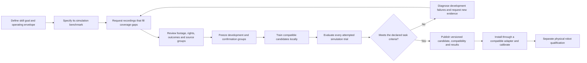

# Execution map: footage to installable skills

Working map, updated 11 October 2026. This is the team's sequence of builds and evidence
gates. A completed software component does not establish robot competence.

## The product loop

Confirmation evidence is opened after a candidate is frozen. Once inspected,
that suite becomes regression evidence for later changes. Further qualification
needs fresh confirmation scenarios; it cannot silently reuse a known test set.

## Current foundation and next builds

The [hardware reference foundation](hardware-reference.md) now separates the
authored box arm from a pinned UR5e/coupled-gripper assembly. Its mechanical
inventory, CPU timestep comparisons and paired replay scorer make the next
hardware gaps measurable. Actual hardware selection, serial/frame calibration,
motor/gripper response, contact/slip evidence and shoe-specific task training
precede physical skill qualification. Left/right five-finger assets are audited
separately; the two-arm assembly remains to be built.

The [upcoming hardware list](hardware-roadmap.md) now tracks YAM, OpenArm, PiPER,
ARX X5 and PAROL6 alongside the proposed SO-101 entry profile. YAM is the first
six-axis candidate; OpenArm is the later two-arm candidate. Each addition needs a
pinned simulator, physical adapter and its own benchmark/qualification evidence.
These are planned targets; their DVIDIA integrations have not been implemented.

The [native grasp task benchmark](native-task-benchmark.md) adds a separate
rigid-block contact task to the pinned reference assembly. Frozen scene plans,
authored placement, recorded-arm/open-jaw and hold controls retain complete
attempts before any learned task policy is qualified. The next action-learning
experiment must replace the task decisions it claims to learn and evaluate the
result in a closed loop. This contact fixture does not establish shoe physics
or physical transfer.

| Order | Build and owner role | Current state | Evidence needed to advance |
| --- | --- | --- | --- |
| 1 | Collection planning — product + data | Local coverage planner, versioned briefs and declared source-group tallies implemented. | First skill's observable goal, operating envelope, actual recordings and reviewed capture lineage. |
| 2 | Contribution review — data + product | Proposed official-site connection; the local planner imports declarations only. | Immutable review receipts tied to original bytes, plan revision, intended-use permission and complete outcomes; source-group and near-duplicate audits. |
| 3 | Episode evidence — simulation | Recorder preserves state, requests, applied commands, sensor age and authored phases at control boundaries. A compact actuator learner now consumes before-state and issued-command evidence. | Shoe-specific corpus, retained failure cases and synchronized inspector. Sensor-shaped simulator inputs still need hardware counterparts. |
| 4 | Task and state models — learning | Small visual predictor, bounded movement head and next-boundary actuator predictor; outcome/phase supervisor proposed. | Compare with matched baselines and measure held-out boundary, outcome and false-completion errors. Keep authored labels and future state outside deployment inputs; qualify sensed physical inputs separately. |
| 5 | Task simulation — simulation | Earlier rigid-box adapter plus a separate pinned UR5e/Robotiq contact task, complete traces and matched controls. | Measured physical agreement, shoe-specific assets/contact, calibrated sensors and independently observable task outcomes on every additional embodiment. |
| 6 | Qualification and sample efficiency — evaluation | Local benchmark runner and frozen sample-count evidence exist. | Learning curves over independent source groups, multiple collection orders, frozen candidates, nominal/stress/control strata, all attempted trials and measured cost. |
| 7 | Installable skill — runtime | Simulation candidate capsule and compatibility checks exist. | Bundle model, task, observation/action contract, adapter, data/protocol hashes, calibration requirements and artifact-bound qualification results. |
| 8 | Physical transfer — robotics | Unqualified. | Hardware timing/calibration checks, measured limits and a separate supervised physical evaluation. Simulation results alone cannot advance this stage. |

The coverage planner and recorder are available from the current source checkout.
They are not included in the frozen v0.1.0 release or the older Hugging Face pilot.
No new task policy is trained by adding these components.

## First incoming skills

The [laptop skill pilot](laptop-skill-pilot.md) supplies a proposed shoe collection
plan and a separate CPU actuator-learning experiment. It uses twelve native
scene groups and three jaw-command interventions per group, with training,
development and frozen test partitions. Its seven outputs predict joint/jaw
changes at one 20 ms boundary; it is neither a shoe policy nor a contact/outcome
model. Physical shoe sensing, shoe task physics and robot integration remain
the next task-specific builds.

Start with one bounded task and one supported robot/gripper rather than declaring
a universal skill. For shoe organization, distinguish pairing, alignment and
placing on a shelf: each needs a goal, observable result and task environment.
Record initial conditions, the complete attempt and its outcome. Five- or
six-second clips are useful when they contain that whole transition. Preserve
longer originals and shared recording/session/object IDs across every cut.

Collection starts with selected high-value conditions: different physical
instances, starting poses, views, clutter, failed grasps and recoveries. Initial
quotas are workload estimates. Use development errors to refine the plan;
version any changed brief and re-review earlier evidence against it. Freeze
confirmation groups before fitting or adjusting the policy.

Human footage can support visual representations and task labels. Joint commands,
forces and calibrated geometry require robot telemetry or a validated action
bridge. Synthetic variations preserve their parent lineage and are reported
separately from independently captured evidence. Shoe tying needs a deformable
task environment; it cannot inherit the rigid-box adapter's qualification.

## What “enough data” means

Report independent groups, conditions and outcomes, not just video count or
seconds. Run nested training subsets while keeping development evidence fixed.
Predeclare the target success, false-completion and critical-error limits with
uncertainty estimates and a cost budget. Freeze the selected candidate before
opening fresh confirmation trials. A plateau below the target calls for a
diagnosis of observations, actions, model or simulator, not a “done” badge.

Collection coverage, usable data, trained candidate, simulation qualification and
physical qualification remain separate states. A collection quota cannot promote
any of the later states.

## Every skill's benchmark contract

At creation, record a success predicate, meaningful failure cases and whether an
environment exists. A missing environment blocks qualification while collection
and environment work continue. The planner's description is the start of the
contract; an executable benchmark additionally needs:

- Task/environment, asset, physics, controller and sensor versions; observation
  and action units, coordinate frames, degrees of freedom and gripper limits.
- Reset distributions, seeds, episode timeout and nominal, stress, recoverable,
  impossible-task and sensor-fault strata where applicable.
- Authored/simple baselines and matched negative controls; a policy hash and
  frozen dataset/protocol hashes before evaluation.
- All attempted episodes, including failures, errors and incompatibilities;
  success, false completion, recovery and critical-error rates with denominators.
- Wall time, step throughput, end-to-end control latency and memory with named
  hardware and measurement boundaries. CPU-only support is measured per task.
- A supported operating envelope and explicit simulation-only or physical scope.

The next learning milestone is a [small native action policy](native-grasp-learning.md)
that chooses all six arm targets and the gripper command, compared with the
authored contact baseline in fresh closed-loop trials. A synchronized tape
inspector and task outcome model support diagnosis, while additional robot
profiles each need their own controls and benchmark. The first real Skillspace
will test the collection/review and action-supervision bridge. See
[collection design](skillspace-coverage.md), [episode evidence](episode-tape.md)
and the [native task protocol](native-task-benchmark.md).

## Observation Lab next version

[Observation Lab v0.2 plan](observation-v0.2-plan.md) prioritizes independent
reference scoring, box and event correction, bounded offline batches, reviewed
dataset export and [causal motion prediction](motion-prediction-plan.md). Image
speed/forecasts, calibrated metric motion and real-time robot interaction have
separate evidence gates. It separates the software release from measured annotation
quality and keeps visual labels distinct from robot action supervision. Grouped
review and autosave are already implemented; the next evidence gate is the
planned complete-task cohort with blinded references and measured review effort.

The [first image-motion alpha](motion-observations.md) is now runnable from the
candidate source checkout: one manually seeded region, causal sparse-feature
translation, image-anchor velocity, 100/250/500 ms constant-velocity forecasts,
authored benchmark scoring and read-only replay. Its original source clocks,
hashes, tracking losses and conditional score denominators are retained.
The published Observation Lab v0.1 tag/Space remain unchanged and the full v0.2
has not shipped. Real-scene anchor references, correction/export integration,
bounded live observation, calibration and action-conditioned interaction still
need their respective evidence gates. Motion speed is analysis-image pixels/s;
no physical speed or robot control follows from these forecasts.

## Reaction and stopping evidence

[Reaction framework v0.1](reaction-framework.md) supplies the first reusable
monitor and native linear-actuator/parallel-jaw coupon fixtures. It tests authored
motion/contact/grip/sensor-fault conditions, matched shadow-monitor controls,
sensor age/dropout, and continued physics after a brake request. Reports retain
all attempts, conditional detection rates with uncertainty, invalid denominators,
timing stages, stopping distance, contact/load outcomes and named CPU cost.

This fixture work precedes integration with the six-axis arm. The next gates are
whole-arm geometry, task-specific expected-contact/retention rules, validated
material and actuator behavior, deployable sensing and measured physical stopping
response. Keep the original placement environment and frozen evidence unchanged;
new profiles and benchmark versions identify these additions. A reaction result
supports a task's evidence bundle without replacing task success, numerical
validation or supervised physical qualification.

## Predictive approach and motor memory

[Motor-memory framework v0.2](motor-memory.md) adds separate calibration and task
evaluation to the one-axis coupon. Its learned actuator model projects delayed
robot observations through acknowledged commands; an authored governor varies
approach speed using precision, braking and uncertainty assumptions. Three
matched configurations and speed tiers expose completion time, error at the
claim, overshoot, rest/load loss and runtime cost. Known commanded goals and
synthetic sensing limit what this experiment establishes.

The next learning gates are component ablations, robot-specific geometry and
action adapters, calibrated sensing/contact, and movement supervision from robot
tapes or an independently evaluated human-video action bridge. Phase-specific
expected contacts, bounded recovery and skill-package compatibility need their
own task tests. A latched hold currently ends execution; it does not recover a
slipping load or resume after sensor loss.
