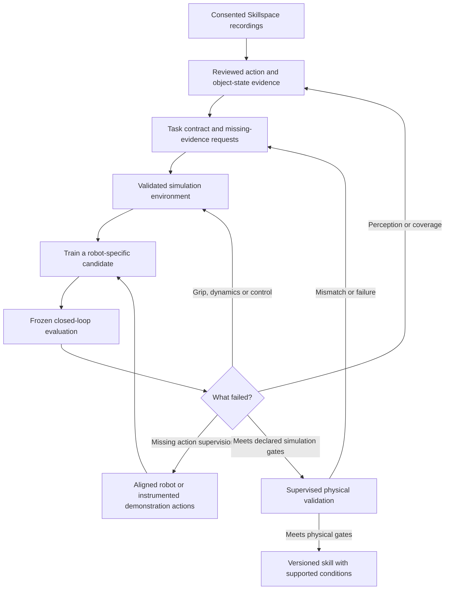

# From a Skillspace video to a tested robot skill

Research and implementation assessment, **15 October 2026**. This is a proposed
development path, not a claim that ordinary DVIDIA uploads currently become
robot policies or that a simulator can cover every possible situation.

**A Skillspace should accumulate evidence about a task, train a candidate for a
specific robot, and earn a narrowly defined capability through tests.** A video
is valuable evidence, but it is only one input. We also need compatible action
data, a task environment, and physical validation before installation on a robot.

## What exists today

| Layer | Current repository capability | What remains unestablished |
| --- | --- | --- |
| Video intake | Real-file probing, hashes, declared source groups and fixed train/development/test partitions | Complete capture provenance and independence cannot be proven by hashes alone |
| Observation review | Timestamped detector proposals, corrections and separate review evidence | A box is not a measured grasp, force, depth or causal explanation; AI agreement is not human-ground-truth accuracy |
| Visual training | Small PCA/ridge next-frame learner and held-out visual diagnostics | Pixel prediction quality is not manipulation success |
| Movement training | Compatible aligned numerical supervision trains the simplified six-joint movement head | Ordinary phone video is not converted into validated robot actions; grip, phases and recovery remain authored |
| Simulation | Bounded placement adapter; separate native robot/contact benchmarks and versioned assets | The simplified movement artifact is not interchangeable with PiPER or UR5e profiles; synthetic object properties are not hardware calibration |
| Improvement loop | Frozen baseline/targeted/general-addition comparison, failure evidence, hypotheses and follow-up requests | The first comparison did not improve completion; it does not establish contributor value, general data efficiency or physical transfer |
| Release | Simulation candidate contracts and qualification evidence | No physical robot qualification for the footage-trained candidate |

These statements are grounded in the [implemented data contract](skillspace-format.md),
[Observation Lab](observations.md), [native task benchmark](native-task-benchmark.md),
and [15 October measured experiment](skillspace-improvement-pilot-20261015.md).
The last experiment tested **16 distinct simulation scenes**, not 112 independent
scenes: its 112 episodes included paired models, teacher and controls. Its shared
stress failure warrants a controller/physical-parameter investigation before
claiming that additional footage will solve it.

## The proposed product architecture

Each Skillspace would own a task contract, observation corpus, action dataset,
environment versions, experiment receipts and a next-contribution queue. Those
are distinct evidence objects. The app can present them as **Collect → Understand
→ Practice → Test**, with one primary next action. A percentage of requested
recordings collected must never be shown as a percentage of robot competence.

The contributor's brief should be concrete: “Record the object slipping during
a short lift, then show a supported regrasp from beginning to end.” It should
include why this condition matters, what must be visible, and whether normal
phone footage or instrumented action capture is needed. If the failure is an
actuator limit, the next action belongs to an engineer instead of a contributor.

## 1. Turn the video into useful task evidence

Preserve the original and record uncertainty. The proposed annotation unit is a
timed event containing:

- An observable verb, object identity and acting hand/tool; start/end intervals.
- Object state before and after, such as supported, lifted, slipping, released
  or settled. Distinguish directly visible state from an inferred interpretation.
- Goal, prerequisite and result: success, failure, recovery, aborted or unknown.
- Contact/occlusion evidence and missing information; a hidden object remains
  unknown rather than acquiring invented geometry or an uninterrupted track.
- Source session, physical object instance, recording lineage, reviewer type,
  annotation revision and permitted uses.

For the user's stool example, the useful structure is “switch out of reach →
move a support into position → gain reach → operate switch,” with the changed
precondition visible. This is a hypothesis about a task dependency, not proof
that a model learned gravity, pain or a general causal law. Do not recreate a
harmful incident to supply a negative example.

AI can propose and cross-check labels now. Measure consistency and reviewer
disagreement separately from accuracy. A small independently reviewed reference
set is needed before reporting real event/object/hand-label accuracy. Keep
temporal boundary errors, missed events and correction effort visible instead
of collapsing everything into a single attractive score.

## 2. Supply a bridge to robot actions

A training pair needs the observation available **at that time** and the command
issued in response, with the robot, units, reference frames, timestamps, sensor
age, limits and command application recorded. Future outcomes and authored task
phase must not leak into a policy that claims to infer them.

| Capture route | Useful output | Requirement before action learning |
| --- | --- | --- |
| Ordinary chest/handheld video | Task semantics, appearances, state transitions, failures and coverage | No automatic motor-supervision claim; robot joints, scale and contact forces are not directly recorded |
| Robot teleoperation | Camera/encoder observations and issued robot actions | Calibrate hardware/cameras, measure time alignment, retain intervention and limiter records |
| Instrumented hand-held gripper | Reconstructable tool trajectories and jaw state | Validate tracking, scale, latency and the target robot's reach/kinematic feasibility |
| Simulator demonstrations | Exact declared state/action pairs under the model | Keep simulator origin explicit; validate the dynamics and later test physical transfer |
| Estimated actions from ordinary video | A candidate reconstruction with uncertainty | Independently validate against measured trajectories/actions before treating it as supervision |

UMI is a relevant precedent for the instrumented route: its hand-held gripper
and camera, relative trajectories and latency-aware interface are deliberately
designed to recover deployable action information. That result does not imply
equivalent information is recoverable from any phone video. [UMI, RSS 2024](https://umi-gripper.github.io/)

Robot teleoperation is the most direct next bridge for this pilot. LeRobot's
official workflow separates calibration, recording, policy training and robot
evaluation; it also exposes actual recording cadence. We should measure cadence
and alignment rather than trusting a nominal FPS field. [LeRobot robot workflow](https://huggingface.co/docs/lerobot/main/en/il_robots)

## 3. Build a simulation that tests the intended claim

Start with **one robot, one gripper, one rigid object family and one bounded
pick/place task**. Extend the existing native benchmark rather than generating
an arbitrary photorealistic room and assuming its physics are correct.

The environment contract needs:

| Contract | Evidence needed |
| --- | --- |
| Robot | Pinned URDF/MJCF and asset licenses; actual joint topology, limits, actuator semantics, gripper coupling, collision geometry and controller interface |
| Object and fixtures | Metric size, collision mesh, mass, centre of mass, inertia, support surfaces and joints; measured or explicitly assumed contact properties |
| Dynamics | Gravity, contact/friction/compliance model, actuator response, torque/force limits, delay, timestep and numerical convergence checks |
| Sensors | Camera intrinsics/extrinsics, image processing, encoder frames, latency/dropout/noise and availability masks matching intended deployment |
| Task | Initial-state distribution, goal, independent success predicate, prohibited outcomes, timeout, allowed recovery and reset procedure |
| Learning | Observation/action contract, demonstrations, reward if using reinforcement learning, and separation of training reward from final success evaluation |
| Validation | Physical reference measurements, model discrepancy, versioned assumptions and reproducible scene/run receipts |

Depth or multi-view reconstruction can help with shape and relative position.
It does not, by itself, establish mass, friction, stiffness, actuator force or a
correct contact model. Unknowns need measurements or bounded assumptions. A
generative video of a successful grasp is not a physics validation. MuJoCo's
modeling documentation explains the explicit modeling choices for contacts,
friction, constraints and actuators; those choices remain part of the experiment.
[MuJoCo modeling reference](https://mujoco.readthedocs.io/en/stable/modeling.html)

MimicGen provides a relevant pattern for expanding compatible source robot
demonstrations across task variants. Its generated trajectories still require
a suitable task/environment and validation; copied or transformed trajectories
are not independent physical demonstrations. [MimicGen, CoRL 2023](https://mimicgen.github.io/)
RoboCasa offers reusable household task/environment structure, including atomic
and composite tasks. We can consider an adapter when its domain fits; it does
not replace calibration of our chosen robot or object. [RoboCasa project](https://robocasa.ai/)

## 4. Cover important possibilities, and recognize the boundary

No finite dataset or simulator enumerates all real-world possibilities. The
deliverable is a **declared operating envelope with measured coverage and a
defined response outside it**. For placement, specify reachable object/target
regions, supported sizes/materials/masses, allowed clutter, camera placement and
gripper capability. An unreachable target should trigger refusal, not count as
a recoverable placement failure.

Use four complementary suites:

1. **Nominal:** representative independent resets inside the envelope.
2. **Boundary and interaction:** small objects near the jaw limit, heavy/low-friction
   combinations, edge-of-reach targets and supported recovery cases. Vary physical
   and perceptual factors separately before combining them.
3. **Fault/refusal:** stale camera frames, missing object, sensor disagreement,
   infeasible payload, unexpected contact or a person entering the workspace.
   Predeclare whether the expected response is bounded recovery, hold, retreat
   or stop, and validate that response physically before relying on it.
4. **Held-out families:** objects, sessions, material/geometry combinations and
   environments excluded from training and model selection—not just new random
   frame indices from the same recording.

Sample common conditions by expected use and oversample rare consequential
failures for diagnosis. Report strata separately so an easy-case majority cannot
hide failure at the boundary. Randomization should use justified ranges and
correlations; impossible parameter combinations distort learning. An adversarial
search can discover new failures, which then become development cases. A fresh,
sealed confirmation suite is required for the next improvement claim.

An out-of-distribution detector or confidence score is only another fallible
component. Combine tested monitoring with explicit command limits, sensor-fault
handling and a safe-stop path. Low uncertainty is not permission to exceed the
hardware's limits.

## 5. Learn, measure, and expand only when evidence supports it

The near-term learner should own the actions it claims to learn. Compare a
small behavioral-cloning policy with the authored baseline on causal sensor
history, then consider larger vision/action models if the simple baseline's
limitations warrant it. Keep perception-only and privileged-state ablations
separate. A model benefiting from exact simulator object pose has not established
camera-based skill transfer. See the existing [native learning proposal](native-grasp-learning.md).

Build learning curves over independent source groups and repeated group
selections. Add a targeted batch and a comparable general batch, freeze training
and evaluation, and measure paired changes. There is no universal number of
clips that turns a task into a skill. Stop asking for more of the same footage
when performance plateaus; investigate sensing, missing action information,
contact modeling, control limits or model capacity instead.

Keep these scores separate:

| Question | Measurement |
| --- | --- |
| Are annotations usable? | Independent-reference event/object/hand accuracy, timing error, missing-event rate and human correction time |
| Does the candidate do the task? | All-attempt completion, false completion, drops, recovery/abort rates, duration, placement error and command-limit violations |
| Does new data help? | Paired change versus frozen baseline, repeated cohort selections, uncertainty and regressions by condition |
| Can the robot execute it? | Physical outcomes, sensor-to-actuation latency/deadline misses, stopping/recovery behavior and sim/real discrepancy |

**Proposed discussion thresholds, not achieved results or universal deployment
criteria:** for the first bounded simulation placement pilot, consider a
one-sided 95% confidence lower bound above 90% nominal completion and above 80%
completion in the explicitly recoverable stress stratum. Select the sample
size and analysis before confirmation, accounting for dependent cases and paired
comparisons. No observed dangerous contact or false success is required, but
zero observed events does not prove zero risk. Impossible/fault cases have
their own refusal criteria. Physical release needs separately agreed risk and
task requirements; these toy-pilot percentages do not authorize it.

## 6. Practical resources and first release

The existing small simulator/movement experiments run on CPU. That does not
price or size a vision-language-action training job. For each proposed larger
model, first run a bounded local benchmark and measure GPU/CPU memory, training
step time, data throughput, full observation-to-command latency and useful
learning progress. Choose the accelerator and budget from those measurements;
do not buy capacity based on clip count alone.

For a first physical pilot we need a compatible arm/gripper, teleoperation
interface, cameras and calibration target, repeatable object/support fixture,
independent stop mechanism, a supervised operator, and instrumented outcome
capture. Start with measured rigid-object placement. Cloth, shoes, articulated
objects, bimanual manipulation and locomotion require additional contracts and
evidence. More robot degrees of freedom enlarge the action and sensing problem;
they do not automatically make an existing seven-command artifact transferable.

The release artifact should bundle model/processor versions, robot identity,
observation/action units and frames, supported envelope, known failure modes,
measured evaluation receipts and rollback behavior. Publish separate statuses:
**Observations reviewed**, **Action data available**, **Simulation tested** and
**Physically validated**. Only the last is evidence for the specific tested
hardware/task conditions.

The immediate sequence is to finish the shared grip/recovery diagnostic, choose
the native robot profile for action learning, measure the simulation against
physical traces, and collect the first aligned demonstrations. Ordinary user
videos can already improve task definitions and identify useful variations while
that bridge is built. Their value should be assessed through later measured
improvement, rather than inferred from upload volume.

## Primary references checked on 15 October 2026

- [UMI](https://umi-gripper.github.io/), RSS 2024: instrumented demonstrations and
  an action/deployment interface.
- [MimicGen](https://mimicgen.github.io/), CoRL 2023, code release July 2024:
  demonstration-based task data generation.
- [MuJoCo modeling](https://mujoco.readthedocs.io/en/stable/modeling.html), living
  official documentation: physical model and contact/actuator configuration.
- [LeRobot real-world workflow](https://huggingface.co/docs/lerobot/main/en/il_robots),
  living official documentation: calibration, capture, cadence and policy rollout.
- [RoboCasa](https://robocasa.ai/), project page checked with its 14 October 2026
  update: reusable task/environment and subtask-labeling structure.
- [robomimic dataset inspection](https://robomimic.github.io/docs/tutorials/dataset_contents.html),
  official v0.5 documentation: trajectory/environment metadata, video and action
  replay. Useful for interchange checks, not an integration already completed here.

External findings inform the proposed design. No external dataset, model or
service was installed by this document, and no private media was exported.
